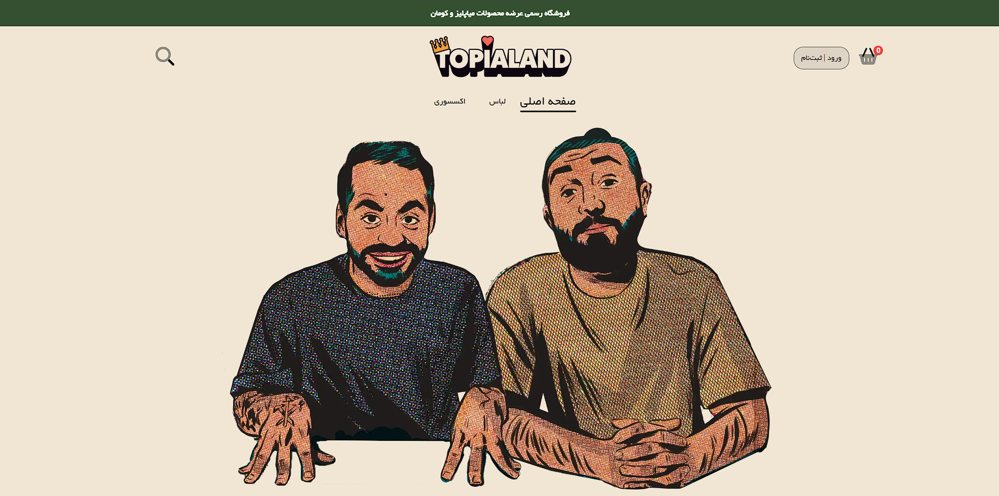
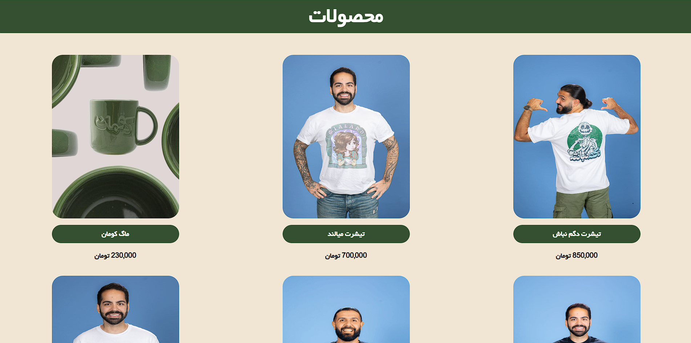
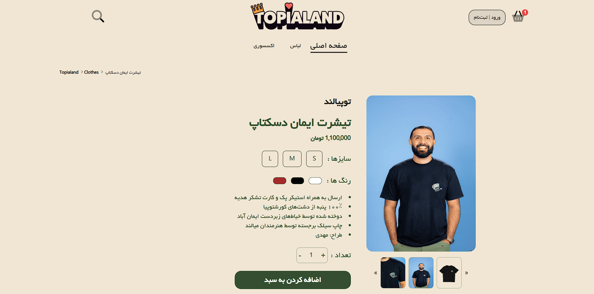
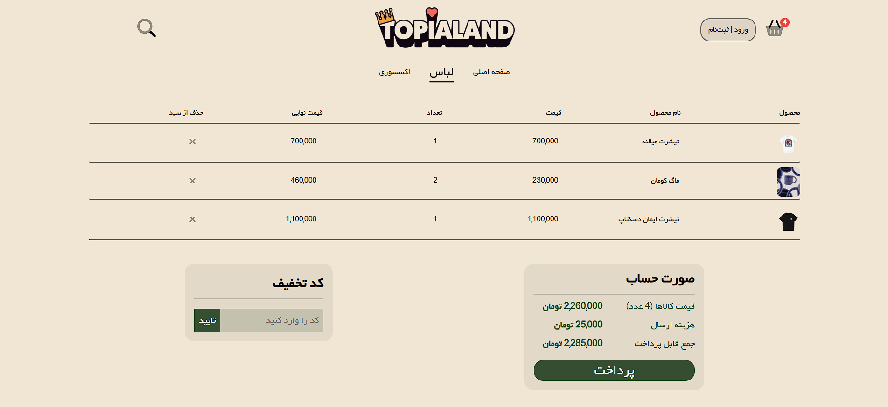
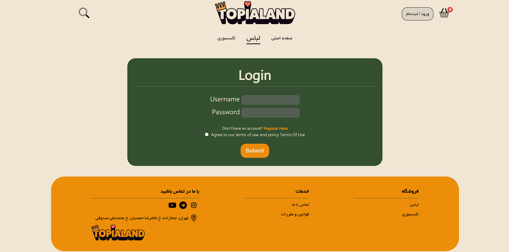

# Project Kouman

## 📌 Overview

**Project Kouman** is a front-end e-commerce–style web application built with **React**, **JavaScript**, **HTML**, and **CSS**. It uses **React Router** for client-side navigation and **Vite** for fast development and builds.

The UI and overall layout were inspired by the real-world website **TOPIALAND.IR**. This project was created strictly for **learning, practice, and portfolio purposes**.

🌐 **Live demo:** https://erfankhadiv.github.io/Kouman/

---

## 📸 Preview

<p align="center">
  
  
  
  
  
</p>

---

## 🛠️ Tech Stack

- **React 19** with hooks, Context API and `useReducer`
- **JavaScript (ES Modules)**
- **HTML5** and **CSS3**
- **React Router 7**
- **Vite 7**
- **ESLint**
- **Node.js built-in test runner** (`node --test`)
- **GitHub Actions** for CI and deployment to GitHub Pages

---

## ✨ Features

- Multi-page navigation with **React Router**, with the active menu item driven by the URL
- Shared **Header** and **Footer** across all pages
- Product listing pages (Clothes & Accessories) and product details via URL parameters
- **Shopping cart**: add, increase/decrease quantity, remove, saved in `localStorage`, quantity capped at 99
- **Discount code** form on the cart page (demo code: `KOUMAN10` = 10% off)
- **Product search** (`/search?q=...`)
- **Persian / English language switch** with automatic RTL / LTR layout; the choice is saved in `localStorage`
- Login / Register page with form validation (UI only, no backend)
- Custom **404 page**, including for unknown product IDs
- Scroll to top on every route change
- Accessibility: semantic landmarks, real buttons, `aria-label`s, meaningful `alt` text, visible focus styles, `prefers-reduced-motion` support
- Responsive layout

---

## 🧭 Pages & Routes

| Route                 | Description                |
| --------------------- | -------------------------- |
| `/`                   | Main page with banner      |
| `/clothes`            | Clothes products page      |
| `/accessory`          | Accessories products page  |
| `/product/:productId` | Product details page       |
| `/search?q=...`       | Product search results     |
| `/loginsignup`        | Login & register page      |
| `/cart`               | Shopping cart page         |
| `*`                   | 404 page                   |

---

## 🚀 Getting Started

Requirements: **Node.js 20 or newer** (the CI uses Node 22).

```bash
# 1. Clone the repository
git clone https://github.com/ErfanKhadiv/Kouman.git
cd Kouman

# 2. Install dependencies
npm ci

# 3. Start the dev server
npm run dev
```

### Available scripts

| Command           | What it does                                   |
| ----------------- | ---------------------------------------------- |
| `npm run dev`     | Start the Vite dev server                      |
| `npm run build`   | Create a production build in `dist/`           |
| `npm run preview` | Preview the production build locally           |
| `npm run lint`    | Run ESLint                                     |
| `npm test`        | Run unit tests (cart logic, translation keys)  |

---

## 🚢 Deployment

The site is deployed to **GitHub Pages** by a GitHub Actions workflow (`.github/workflows/deploy.yml`) on every push to `main`:

1. Install dependencies (`npm ci`)
2. Lint, run tests, build
3. Copy `index.html` to `404.html`, so deep links such as `/Kouman/cart` still work after a refresh (GitHub Pages has no SPA fallback)
4. Publish the `dist/` folder

Notes:

- In **Settings → Pages**, the source must be set to **GitHub Actions**.
- `vite.config.js` sets `base: '/Kouman/'` and the router uses `import.meta.env.BASE_URL` as its `basename`, so the same code works on GitHub Pages and in local development.

---

## 📂 Project Structure

```
Kouman/
│
├── .github/workflows/deploy.yml   # lint → test → build → deploy
├── public/                        # fonts, icons, screenshots
├── tests/                         # unit tests (cart logic, i18n)
│
├── src/
│   ├── Components/
│   │   ├── Assets/                # product images, banner, product data
│   │   ├── Banners/
│   │   ├── Breadcrumbs/
│   │   ├── Footer/
│   │   ├── Header/
│   │   ├── Items/
│   │   ├── ProductPage/
│   │   ├── ProductsDisplay/
│   │   └── ScrollToTop/
│   │
│   ├── Context/                   # products + cart state (useReducer)
│   ├── i18n/                      # Persian / English translations
│   ├── Pages/
│   │   ├── CSS/
│   │   ├── MainPage.jsx
│   │   ├── Clothes.jsx
│   │   ├── Accessory.jsx
│   │   ├── ProductInfo.jsx
│   │   ├── Search.jsx
│   │   ├── LoginSignup.jsx
│   │   ├── Cart.jsx
│   │   └── NotFound.jsx
│   │
│   ├── utils/
│   ├── App.jsx
│   ├── index.css
│   └── main.jsx
│
├── CHANGES.md                     # detailed changelog
├── index.html
├── package.json
├── vite.config.js
└── README.md
```

---

## 🎯 Purpose of the Project

- Practice building real-world React applications
- Learn React Router and component-based architecture
- Practice state management with Context and `useReducer`
- Improve front-end UI/UX and accessibility skills
- Create a portfolio-ready project

---

## ⚠️ Disclaimer

This project is **not affiliated with or endorsed by TOPIALAND.IR**. All design inspiration was used only for educational purposes. No backend services, proprietary data, or private APIs were used. The login form and the checkout button are UI only.

---

## 📝 License

This project is licensed under the MIT License.
See the [LICENSE](LICENSE) file for details.

---

## 👤 Author

**Erfan Khadiv**

GitHub: <https://github.com/ErfanKhadiv>

---

## ⭐ Acknowledgements

- Inspiration: **TOPIALAND.IR**
- React & Vite documentation
- Open-source community
